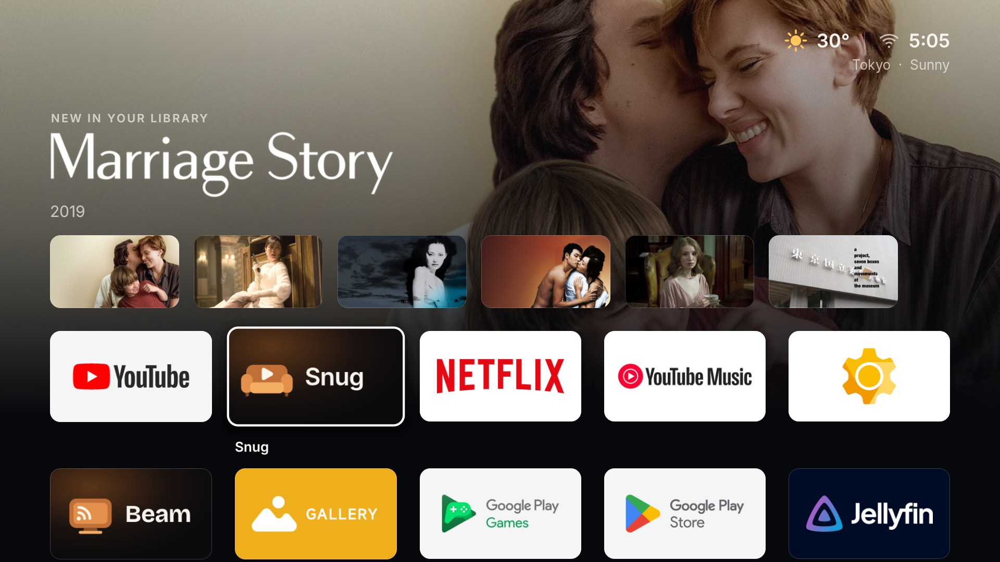

# Snug — Android TV

<p align="center"></p>

A native Android TV client for [Jellyfin](https://jellyfin.org), built for the remote. Browse your movies and TV shows from the couch, pick up where you left off, and play 4K files straight from the server whenever the television can decode them. With no server, it can also play films straight off a USB drive plugged into the box ([Drive mode](#drive-mode-no-server)).

Alongside it, [Snug Home](#snug-home) is an optional home screen for the box.

Snug installs beside the official Jellyfin app: its package is `tv.livingroom.watch`, not `org.jellyfin.androidtv`.

## Features

**Browsing**
- Finds Jellyfin servers on the home network by itself, or takes a typed address (`http://` and `:8096` are filled in when left out).
- Profile picker, with password entry only for profiles that need one, plus Quick Connect: the TV shows a code you approve from the Jellyfin app on your phone.
- Home with a featured title and shelves: Continue watching (titles stopped part-way and the next episode of each show, in one row), Unwatched, Favorites, the four biggest genres, Recently added, and TV shows with new episodes.
- A show can be hidden from Continue watching from its page; it comes back when you next play an episode. The list is kept on the server, so the web version shares it.
- An optional screensaver fades through the library's backdrops with the time after a few idle minutes on a menu, and optional theme music plays softly on show and movie pages.
- Home opens instantly with the last copy kept on disk, then refreshes. Pictures arrive as WebP with BlurHash placeholders, and the next posters and backdrops are fetched ahead.
- Full movie and TV show grids with sort, an Unwatched filter and Jump to letter, genre tiles, and search by voice (the remote's microphone or Search key) or with an on-screen keyboard, with recent searches.
- Title logos, format badges (4K, Dolby Vision, HDR10, Atmos, 5.1) and a Trailer button on title pages.
- Continue watching also appears on the TV's own home screen (Google TV and Android TV's Play next row).
- Switch profile keeps each profile signed in on the TV, so switching back needs no password.
- TV shows: a grid of shows, and a page per show with a Play or Resume button for the next episode, seasons as tabs, and the episode list with progress and watched marks. When an episode ends, the next one starts after a 10-second countdown.
- Title page with resume and start-over, favourite and watched toggles, format badges, and subtitle and audio pickers.
- A side rail for sections. Back always returns focus to the poster or button you came from.

**Playback** (Media3 / ExoPlayer)
- On start the app checks which hardware decoders the television has, and the largest picture each handles smoothly, and sends Jellyfin a matching device profile. A TV that can't play 4K HEVC or AV1 smoothly gets a converted stream instead of a stutter.
- Files the television can decode — MKV and MP4, including 10-bit HEVC on TVs that support it — play directly with no work on the server.
- If only the container or audio is unsupported, the server repackages the stream over HLS without re-encoding the picture. A full re-encode happens only when the television cannot decode the video, and is capped at 1080p.
- If a file still fails, the player steps down one level at a time: repackage, then convert only the sound, and re-encode the picture only when the video decoder is the problem. A dropped connection is retried once first.
- Dolby Vision files without an HDR10 fallback (profile 5) are converted on TVs without a Dolby Vision decoder, so they don't show purple and green.
- The TV switches to a refresh rate matching the film (for example 23.976 Hz), so slow pans don't judder, and switches back when the player closes.
- Up to about two minutes of video is buffered, and a Wi-Fi lock is held while playing, so high-bitrate files ride out Wi-Fi dips.
- Thumbnails while skipping through a title, when the server has made trickplay pictures (Jellyfin 10.9+).
- Resume position (a few seconds early, so you catch the line you missed), skips, chapters, playback speed, and progress reported to Jellyfin.
- Skip intro, Skip recap and Skip preview buttons when the server has marked those parts (for example with the Intro Skipper plugin), and an Up next card as the credits start.
- After a few episodes in a row with nobody touching the remote, the Up next card asks whether you're still watching, and playback stops at the credits unless you answer.
- A Playback info panel (the Info button, or the remote's Info key) says whether the video is playing straight from the drive, repackaged or converted by the server and why, which decoder the TV is using, the screen's refresh rate, dropped frames and how much is loaded ahead.
- Text subtitles are drawn by the app, so size and timing changes are instant. Image subtitles (PGS, DVD) use the television's decoder when playing directly.
- Online subtitle search through the Jellyfin OpenSubtitles plugin.

**Settings**
- How long player controls stay up, frame-rate matching, how far to jump back when resuming, when to ask if you're still watching, the screensaver and theme music, subtitle size and preferred language, automatic subtitle downloads, the OpenSubtitles login, changing server, and sign out.

## Drive mode (no server)

Snug can also play films straight off a USB drive plugged into the TV box, with no Jellyfin server. Pick **USB drive** on the server screen, or **Settings → Play from a USB drive**. Jellyfin stays signed in underneath: **Settings → Use Jellyfin instead** goes straight back to it.

- Snug reads one movies folder on the drive (see [Choosing the movies folder](#choosing-the-movies-folder)). It doesn't read anything outside that folder.
- Films can be in A to Z folders, each in a folder named `Title (Year) [tags]` (the YTS style), or loose files named the same way. `.srt` files beside the film or in a `Subs` folder are its subtitles; subtitles inside the file work too, including image ones.
- Posters, backdrops, logos, plots, cast and genres come from [TMDB](https://www.themoviedb.org). Put a free TMDB API key in **Settings → TMDB key**, or send it from a computer: `adb shell am start -n tv.livingroom.watch/.MainActivity --es tmdbKey KEY`. Details are kept on the box, so the library still shows with the drive unplugged.
- Continue watching, where each film stopped, watched marks and favourites are kept on the box. Snug Home's shelf and the TV's Play next row show the drive's films too.
- Android has to let Snug read the drive ("All files access"). Where the box has no screen for that, run once: `adb shell appops set --uid tv.livingroom.watch MANAGE_EXTERNAL_STORAGE allow`.
- Files play as they are, since there's no server to convert them.
- On the Xiaomi TV Box S, the USB port only reads drives while USB debugging and Wireless debugging are both off.

### Choosing the movies folder

Your drive can hold anything else besides films: Snug only reads the one folder you give it.

**Found by itself.** If you don't choose a folder, Snug looks at the folders at the very top of the drive for one named `Movies`, `Movie`, `Films` or `Film`. Upper or lower case doesn't matter (`MOVIES` and `movie` both work). Only the names of the top folders are looked at, never what is inside the others. A folder deeper down, such as `Media/Movies`, isn't found by itself; choose it as below.

**Choosing it yourself.**

1. Plug the drive into the box.
2. Open **Settings → Movies folder**. It lists the plugged-in drives.
3. Pick the drive, then open folders with OK until you reach the one that holds your films. Back goes up a folder.
4. Press **Use this folder**. Snug lists the films in it straight away.

To go back to finding it by itself, open **Settings → Movies folder** and pick **Find it by itself** at the top of the list.

Snug remembers the folder as a path from the top of the drive (for example `Media/Videos/Movies`), so it still works after you unplug the drive, after a restart, or with another drive that has the same folders. If the folder isn't on the plugged-in drive, **Settings → Movie drive** says "No movies folder".

Snug checks the folder again whenever the drive is plugged in and whenever you come back to Snug (at most once a minute), so films you add or delete show up by themselves. Pressing **Settings → Movie drive** checks it straight away.

A layout that works well:

```
Movies/
  The Matrix (1999) [1080p]/
    The.Matrix.1999.1080p.mkv
    The.Matrix.1999.1080p.en.srt
    Subs/
      2_English.srt
  Inception (2010).mp4
  Inception (2010).en.srt
```

Folders inside it (an A to Z split, for example) are fine, up to four levels deep. In a film's own folder the biggest video is the film; anything named `sample` or `trailer`, and `Extras`, `Featurettes` or `Trailers` folders, are left out. A `poster.jpg` or `folder.jpg` next to the film is used when TMDB has no poster.

Good to know:

- Snug remembers each film by its path inside the movies folder. Choosing a different movies folder (even the one above it), or renaming or moving a film, makes Snug see it as a new film: Continue watching, where it stopped, watched marks and favourites start again for it, and it is looked up on TMDB again. So pick the folder once and keep it.
- Put the year in the folder or file name (`Title (Year)` or `Title.Year.1080p`). TMDB is searched by name and year, and without the year it can pick the wrong film with the same name.
- Video files under 40 MB are skipped, so samples and short clips don't show up as films.
- A subtitle file's language comes from its name (`.en.srt`, `English.srt`). Snug knows English, Vietnamese, Spanish, French, German, Portuguese, Italian, Japanese, Korean, Chinese, Thai, Indonesian and Russian; other subtitles still play, just without a language name.

## Remote controls

| Button | In the player |
| --- | --- |
| Center / Play-Pause | Play or pause |
| Left / Right | Skip 10 s (hold for 30 s) |
| Fast-forward / Rewind | Skip forward / back |
| Up / Down / Menu | Show controls |
| Info | Playback info |
| Captions | Subtitle options |
| Back | Close a panel, then hide the controls, then leave the player |

## Install

Download `Snug-<version>.apk` (for example `Snug-1.15.1.apk`) from the [latest release](https://github.com/neothebyte/snug-tv/releases/latest), then sideload it:

```bash
adb connect <tv-address>:5555
adb install -r Snug-1.15.1.apk
```

The optional [home screen](#snug-home) has its own releases, tagged `home-v<version>` (see [Snug Home releases](https://github.com/neothebyte/snug-tv/releases?q=home-v&expanded=true)).

To try a build before it is released, open a pull request's run under **Actions → Release** and download the `Snug-<version>` artifact (a zip with the APK inside; `SnugHome-<version>` is beside it). They are signed with the same release key as local builds, so they install over the app already on the television.

On the television, open **Snug**, pick your server (or enter its address, for example `192.168.1.10`), and choose a profile or use Quick Connect. To play from a USB drive instead, pick **USB drive** (see [Drive mode](#drive-mode-no-server)).

Requirements: Android TV or Google TV on Android 7.0 (API 24) or newer, and either a Jellyfin 10.10+ server on the local network or a USB drive with films and a free TMDB key. The app talks to Jellyfin over plain HTTP, which is intended for a home LAN.

Current limits: movies and TV shows are shown (no music or Live TV yet), and Drive mode reads films only, not TV shows. Large libraries load from the server a page at a time, so there is no size cap.

## Build from source

Requires JDK 17 or newer and the Android SDK (platform 35).

```bash
export JAVA_HOME=/path/to/jdk-17-or-newer
export ANDROID_HOME="$HOME/Library/Android/sdk"   # or your SDK path
./gradlew assembleRelease
```

Snug is written to `app/build/outputs/apk/release/app-release.apk` and Snug Home to `home/build/outputs/apk/release/home-release.apk`.

GitHub also builds both APKs for every push and pull request: open the run under **Actions → Release** and download the `Snug-<version>` and `SnugHome-<version>` artifacts. On `main`, the same workflow publishes each app as its own GitHub Release once its `versionName` changes: Snug as `v<version>` with `Snug-<version>.apk` (from `app/build.gradle.kts`), and Snug Home as `home-v<version>` with `SnugHome-<version>.apk` (from `home/build.gradle.kts`). Snug Home's releases are never marked latest, so the latest release is always Snug.

Release builds are signed with the release key when these properties are set, in `~/.gradle/gradle.properties` locally or as environment variables:

```properties
LIVINGROOM_KEYSTORE=/path/to/livingroom-release.jks
LIVINGROOM_KEYSTORE_PASSWORD=...
LIVINGROOM_KEY_ALIAS=livingroom
```

GitHub Actions reads the key from the `LIVINGROOM_KEYSTORE_BASE64` and `LIVINGROOM_KEYSTORE_PASSWORD` repository secrets. Without them, release builds fall back to the debug key, which will not install over a release-signed app. Keep a backup of the keystore: if it is lost, every television has to uninstall the app before installing a build signed with a new key.

## Project layout

```
app/src/main/java/tv/livingroom/watch/
  MainActivity.kt      Entry point
  LivingRoomApp.kt     Navigation and app shell
  Screens.kt           Sign-in, Home, grid, search, genres, detail, settings
  Components.kt        Posters, rails, dialogs, focus styling
  PlayerActivity.kt    Media3 player, controls, panels, progress reporting
  Extras.kt            Screensaver and theme music
  DeviceCodecs.kt      Decoder probing and Jellyfin device profile
  DisplayRate.kt       Refresh-rate matching for the player
  JellyfinClient.kt    Jellyfin REST client (OkHttp)
  AppModel.kt          State and actions
  ServerDiscovery.kt   Finding servers on the network
  SessionStore.kt      Saved server and session
  Library.kt           The two sources: Jellyfin or Drive mode
  DriveLibrary.kt      Drive mode: the library, progress and favourites kept on the box
  DriveScanner.kt      Finding films in the drive's Movies folder
  Tmdb.kt              Film details and pictures from TMDB, for Drive mode
  HomeCache.kt         The last Home on disk, for an instant start
  WatchNext.kt         Continue watching on the TV's own home screen
  ShelfProvider.kt     Snug Home's top shelf
  Models.kt, Theme.kt
core-ui/               Colours, type, focus and motion, and BlurHash, shared by Snug and Snug Home
home/src/main/java/tv/livingroom/home/
  HomeActivity.kt      Snug Home's entry point: the home screen, which never closes
  HomeScreen.kt        Top shelf, rows of app tiles, moving and hiding apps, ambient screen
  Apps.kt              The installed TV apps, their order and hidden ones
  Shelf.kt             Reading Snug's top shelf
  Weather.kt           Current weather for the box's city (Open-Meteo)
  WeatherCorner.kt     The weather and clock in the top right corner
  Camera.kt            Finding go2rtc and its cameras on the home network
  CameraTile.kt        The live camera tile and its full-screen view
  Theme.kt
```

## Related

- [Snug — Web](https://github.com/neothebyte/snug-web): the browser client for the same server.

## Acknowledgements

- [Jellyfin](https://jellyfin.org) for the server and API.
- [AndroidX Media3](https://github.com/androidx/media), [Jetpack Compose](https://developer.android.com/jetpack/compose), [OkHttp](https://square.github.io/okhttp/) and [Coil](https://coil-kt.github.io/coil/).
- [Inter](https://rsms.me/inter/) typeface (SIL Open Font License).

## Name and logo

The app was called Living Room until version 1.8.1. The couch logo's sources are in `branding/` (`snug-icon.svg`, `snug-banner.svg`). The package id stays `tv.livingroom.watch`, so existing installs update in place.

## Snug Home

<p align="center"></p>

`home/` is a second, optional app (version 0.4.0): a simple home screen for the box in the style of Apple TV.

- The apps sit in rows of five, and a top shelf above them shows what the focused app is. For Snug it shows what you were watching and what's new, read from Snug (`content://tv.livingroom.watch.shelf`, open only to apps signed with Snug's key), including films from Drive mode.
- Hold OK on an app to move it, hide it or open its App info; hidden apps come back from the Hidden apps tile. The TV's own Settings is always the last tile, and only once, even on boxes that list their Settings app too.
- The top right corner shows the weather and the time. The city is found from the box's internet connection (ipwho.is, once a day; Bangkok if that fails), the weather comes from [Open-Meteo](https://open-meteo.com) every half hour, and neither needs a key or an account.
- A home security camera can sit live in the top right of the shelf, under the clock. See [Camera on the home screen](#camera-on-the-home-screen).
- Tiles, the shelf and the last weather are kept on disk, so the home screen is complete on its first frame.
- After five idle minutes an ambient screen fades through Snug's pictures with the time.

Apart from the weather, the only things it loads are the shelf's pictures (from your Jellyfin server, or TMDB for Drive mode films) and, if you have one, your camera from your own network. It keeps no account and sends nothing about you anywhere.

Install `SnugHome-<version>.apk` from the newest [Snug Home release](https://github.com/neothebyte/snug-tv/releases?q=home-v&expanded=true) (tagged `home-v<version>`). On Android TV, set it as the home screen in Settings → Apps → Default apps → Home app (or the TV asks the next time the Home button is pressed); to go back, pick the original launcher there again. Google TV boxes have no such setting: see [Make it the home screen](#sharing-snug-home-with-others) below.

### Camera on the home screen

Snug Home shows a camera that [go2rtc](https://github.com/AlexxIT/go2rtc) streams on your home network, for example on a Raspberry Pi. go2rtc can also stream cameras with no RTSP of their own, such as Xiaomi's (its Xiaomi source, version 1.9.13 and newer).

- There is nothing to set up on the TV. Snug Home looks for go2rtc on its usual port (1984) on the box's own network, then remembers where it found it. With no go2rtc on the network, there is no tile.
- It shows the first stream in go2rtc's list, named after it: a stream called `living_room` shows as "Living room". If there is also a stream called `living_room_sd` (the camera's lighter, lower-resolution stream), the tile plays that one, which is easier on a small box.
- The tile is muted and plays only while the home screen is showing. Select it and press OK to watch it full screen with sound; Back closes it.
- go2rtc's streams are H.265 or H.264 over RTSP (port 8554). Most TV boxes decode both in hardware.

### Sharing Snug Home with others

Snug Home is not on the Play Store, so sharing it means handing out the APK. These are the notes for doing that.

**Install.** Give people the `SnugHome-<version>.apk` from the newest [Snug Home release](https://github.com/neothebyte/snug-tv/releases?q=home-v&expanded=true). It must be the build signed with the release key: that is what lets it read Snug's top shelf, and what lets later versions install over it. Sideload it like Snug:

```bash
adb connect <tv-address>:5555
adb install -r SnugHome-0.3.1.apk
```

**Make it the home screen.** On most Google TV boxes, installing it is not enough: the stock launcher (`com.google.android.apps.tv.launcherx`) keeps taking the Home button, and there is no Default apps → Home app setting to change. Turn the stock launcher off over adb and point Home at Snug Home:

```bash
adb shell pm disable-user --user 0 com.google.android.apps.tv.launcherx
adb shell cmd package set-home-activity tv.livingroom.home/.HomeActivity
adb shell input keyevent KEYCODE_HOME
```

Press Home on the remote to check that Snug Home opens, then restart the box once to check it still does.

To undo it and get the Google TV home screen back:

```bash
adb shell pm enable com.google.android.apps.tv.launcherx
adb shell cmd package set-home-activity com.google.android.apps.tv.launcherx/.home.HomeActivity
```

Most people won't have adb set up, so a one-click script for these steps (like the one used for the Xiaomi TV Box S) would help before sharing it widely. Remind them to turn Wireless debugging off again afterwards; on the Xiaomi TV Box S the USB port doesn't read drives while it's on.

**Updates.** Without the Play Store, nobody gets updates unless they install the new APK themselves.

- [ ] TODO: an in-app update check. Snug Home could look at the newest `home-v…` GitHub release now and then, and when a newer `SnugHome-<version>.apk` is there, offer to download and install it.
